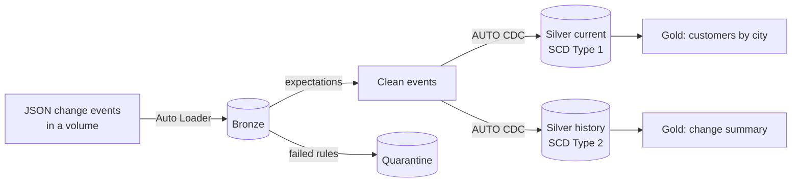

# Customer CDC Pipeline on Databricks

A mini project that turns customer **change data capture (CDC)** events into current and
historical tables using **Lakeflow Spark Declarative Pipelines**. It is written for Azure
Databricks serverless compute and Databricks Free Edition.

## Business problem
A source system sends customer inserts, updates and deletes. Events can arrive out of order,
and some are invalid. Reporting teams need both the latest customer record and its history.

## Architecture



## Tech stack
Databricks, Lakeflow Spark Declarative Pipelines, PySpark, Auto Loader, Delta Lake,
Unity Catalog, Declarative Automation Bundles, pytest, GitHub Actions.

## Features
- Incremental JSON ingestion with an explicit raw schema
- Data quality expectations, plus a quarantine table showing which rules failed
- `AUTO CDC` for inserts, updates and deletes, ordered by `sequence_num`
- Both SCD Type 1 (latest) and SCD Type 2 (history) tables
- Gold materialized views, post-run validation and unit tests
- Pipeline and three-task job defined in YAML

## Project structure
```
├── pipeline/
│   ├── transformations/   # bronze.py, silver.py, gold.py
│   └── utilities/         # testable typing and quality rules
├── notebooks/             # setup and result validation
├── data/                  # generator and sample JSON files
├── tests/                 # pytest unit tests for the rules
├── sql/                   # reporting queries
├── resources/cdc.yml      # pipeline and job definition
├── docs/SETUP_GUIDE.md
└── databricks.yml
```

## How to run
See [docs/SETUP_GUIDE.md](docs/SETUP_GUIDE.md).

## Expected results
These counts follow from the sample data and CDC rules.

| Table | After batch 1 | After batch 2 |
|---|---|---|
| `bronze_customer_cdc` | 104 | 167 |
| `quarantine_customer_cdc` | 4 | 7 |
| `silver_customers_current` | 100 | 105 |
| `silver_customers_history` | 100 | 150 |

Batch 2 has 35 updates (customers `C001` to `C005` change twice), 10 deletes,
15 inserts and 3 invalid events. After it, `C001` has three history versions.

## Run tests locally
Requires Python 3.11 and Java 17. The tests cover the quality rules, not the managed
pipeline or AUTO CDC, which need Databricks.
```bash
pip install -r requirements-dev.txt
pytest -v
```

## Assumptions and future improvements
- Each customer has at most one event per `sequence_num`.
- UPDATE events carry the full customer record.
- Files are never edited after they land.
- Next steps: ADLS Gen2 through a Unity Catalog external location, handling for very late
  deletes, a dashboard and failure alerts.

## Note
All data is synthetic. This is a learning and portfolio project.
